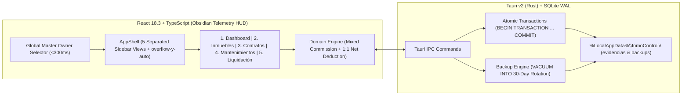

# Technical Design: `inmo-control-v2-core`

## Architecture Overview

InmoControl 2.0 follows a **Local-First Desktop ERP** architecture combining a high-contrast **Obsidian Telemetry HUD** React 18.3 frontend with a **Tauri v2 (Rust) + SQLite WAL** transactional backend.

## Key Design Decisions

### 1. Obsidian Telemetry HUD & Accessibility Tokens
- **Surfaces**: `#0d0e12` (deep background) and `#121317` (panel surface) with `1px` structural borders.
- **Semantic Accents**:
  - Cyan `#00eefc` — primary telemetry, active occupancy `[OCUPADO]`, and interactive focus.
  - Matrix Green `#00FF66` — positive cashflow and available units `[DISPONIBLE]`.
  - Amber `#ffb800` — IPC adjustments, expiring contracts, and pending maintenance tickets.
  - Magenta `#ff007f` — critical alerts, overdue balances, and destructive/handover actions.
- **WCAG 2.1 AA Compliance**: Secondary and muted labels use `#9ca3af` (`text-hud-muted`) against `#121317` / `#0d0e12` to guarantee a contrast ratio exceeding `7.0:1`.

### 2. Five Strictly Separated Views & Global Master Owner Filter
- Rather than crowding all workflows onto a single screen, the UI enforces 5 isolated views controlled by `AppShell`:
  1. `Dashboard`: Executive KPIs, cashflow breakdown, and urgent alerts.
  2. `Inmuebles`: `role="tree"` matrix/sub-unit property hierarchy with `[+]`/`[-]` and `├──` branches.
  3. `Contratos`: Lease registry, IPC countdowns, and `<<<<< EJECUTAR ENTREGA DE INQUILINO DE INMUEBLE >>>>>`.
  4. `Mantenimientos`: Zero-markup 1:1 repair ledger and `%LocalAppData%\InmoControl\evidencias\` attachments.
  5. `Liquidación`: Formula-driven monthly settlement preview and atomic `[ APROBAR // EJECUTAR ]` execution.
- Selecting an owner in the top bar updates `selectedOwnerId` in `ErpContext`, synchronously filtering memoized selectors across all 5 views in `<5ms` (well below the `<300ms` SLA).

### 3. Mixed Commission & Zero Markup Financial Engine
- Implemented as pure functions in `src/lib/domain.ts` and mirrored in Rust SQLite transactions:
  - `percentageFee = Math.round(grossIncome * (commissionPercentage / 100))`
  - `agencyCommission = percentageFee + baseFee`
  - `netMaintenance = sum(ticket.cost)` (strictly `1:1`, `0%` surcharge)
  - `netPayout = grossIncome - agencyCommission - netMaintenance`

### 4. SQLite WAL Atomic Transactions & Local Backups
- **Database Mode**: `PRAGMA journal_mode = WAL; PRAGMA foreign_keys = ON;`
- **Settlement Transaction**: `execute_monthly_settlement` opens an explicit `BEGIN TRANSACTION`, inserts the immutable liquidation record, marks all included `maintenance_tickets` as `LIQUIDADO`, and issues `COMMIT` (or `ROLLBACK` on failure).
- **Contract Handover Transaction**: `terminate_contract_handover` opens `BEGIN TRANSACTION`, transitions the contract status to `FINALIZADO`, updates the linked property/sub-unit status to `DISPONIBLE`, and issues `COMMIT`.
- **30-Day Rotating Backups**: `perform_database_backup` executes `VACUUM INTO '<%LocalAppData%>\InmoControl\backups\inmocontrol_YYYYMMDD_HHMMSS.db'` and prunes `.db` files older than 30 days.
